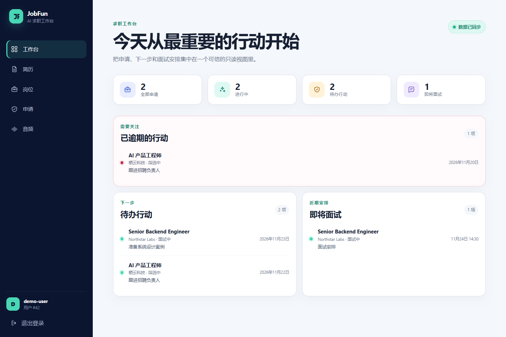
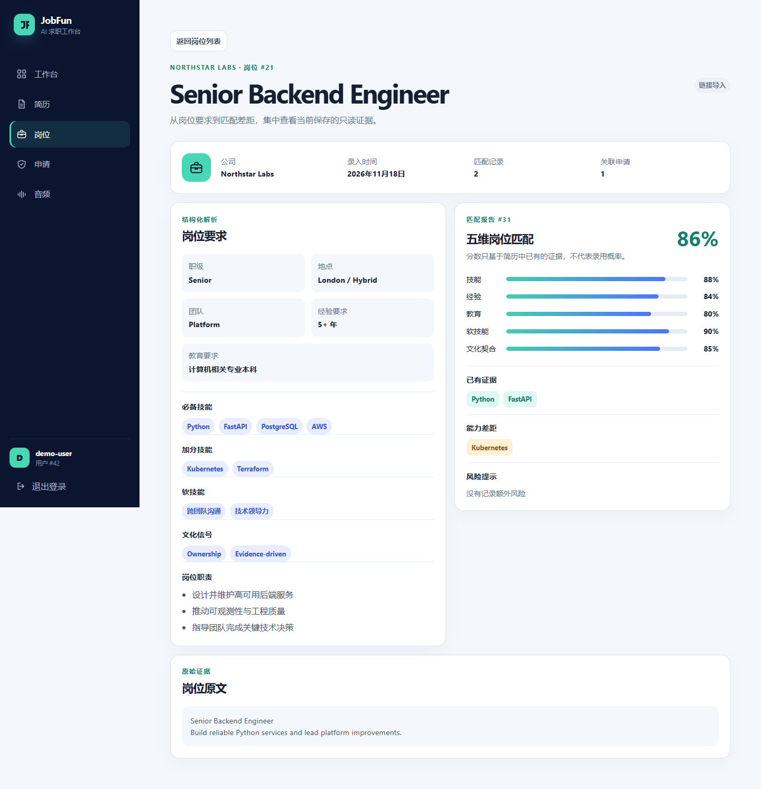
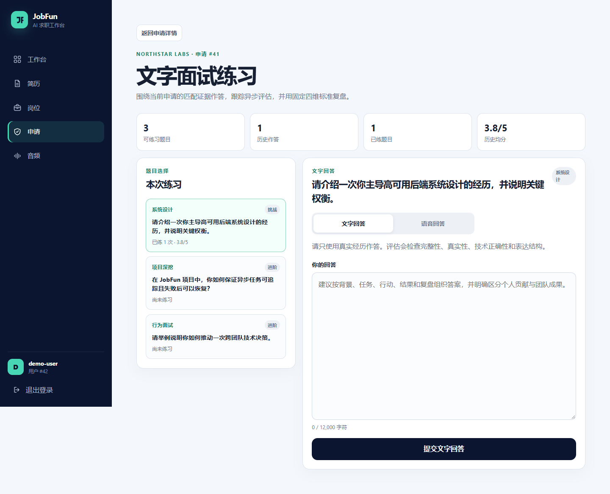
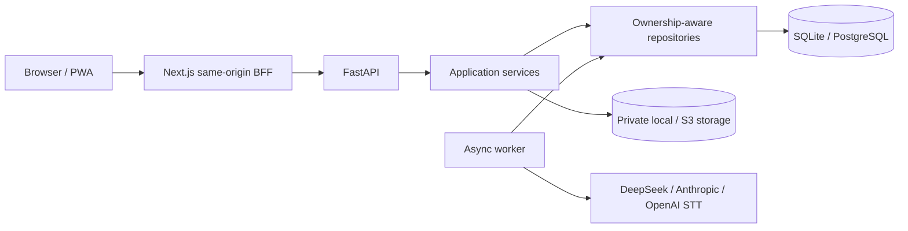

# JobFun

> 证据优先的 AI 求职工作台：把简历证据、岗位匹配、申请推进和面试复盘放进一个可追溯闭环。

[](web/)
[](src/api/)
[](web/src/app/manifest.ts)
[](tests/)



JobFun 面向需要针对不同岗位持续调整申请策略的技术求职者。它不会替用户“生成一段看起来很强的经历”，而是把每条岗位要求关联到用户已经提供的真实证据；找不到证据时明确标记缺口，并让关键修改始终由用户确认。

当前仓库是可本地运行的作品集版本，尚未提供公开在线演示。README 中所有界面截图均由本地 Mock API 和合成数据生成，不包含真实简历或个人申请记录。

## 核心能力

- **简历与岗位导入**：支持文本、PDF、Overleaf ZIP 和岗位截图等输入，并以异步任务跟踪解析状态。
- **证据优先匹配**：从技能、经验、教育、软技能和文化信号五个维度解释匹配结果；分数不是录用概率。
- **岗位差距解释**：在已匹配申请中逐项核对要求与简历原文，生成待确认问题和下一步行动；可选 LangChain 只读工具与临时向量检索提供候选段落。
- **申请闭环**：将岗位、简历版本和匹配报告绑定到同一申请，使用受约束的状态机推进流程。
- **面试练习**：围绕岗位与真实经历生成问题，支持文字回答与受控语音转写，并按完整性、真实性、技术正确性和表达结构反馈。
- **隐私与所有权**：服务端校验用户归属，上传对象默认私有，浏览器脚本无法读取 Bearer Token。
- **可运营性**：提供 Worker 心跳、健康检查、音频保留与清理、聚合趋势、策略审计，以及带 SHA-256/HMAC 验证的安全运维导出。

## 产品界面

### 有依据的岗位匹配

岗位要求、五维得分、已有证据、能力差距和风险提示在同一页面呈现，用户可以追溯每个结论的来源。



### 围绕真实经历练习面试

问题来自当前申请的岗位和匹配上下文；评价会标记需要补证的表达，不会替用户虚构项目结果。



## 工作流

```text
简历 / 真实经历 ─┐
                  ├─→ 证据匹配 ─→ 用户确认 ─→ 简历行动 / 申请行动 / 面试行动
岗位描述（JD） ──┘                         └─→ 投递记录与复盘
```

任何“已匹配”结论都应能回到用户提供的内容。AI 可以重组、解释和优化表达，但不能新增公司、项目、日期、技能、数字或面试经历。

## 技术架构



| 层级 | 主要职责 |
| --- | --- |
| `web/` | Next.js 16 PWA、响应式业务界面、同源 BFF、HttpOnly 会话 |
| `src/api/` | FastAPI HTTP 契约、认证、健康检查与依赖装配 |
| `src/services/` | 用户所有权、幂等写入、状态流转和应用工作流 |
| `src/repositories/` | SQLite/PostgreSQL 持久化边界与适配器契约 |
| `src/core/`、`src/agent/`、`src/ai/` | 证据匹配、工作流编排、Prompt 与模型集成 |
| `src/storage/` | 私有本地对象与 S3 兼容对象存储 |
| `ui/`、`app.py` | 保留回归测试的早期 Streamlit 客户端 |

## 安全与隐私设计

- Token 只通过 Next.js Route Handler 写入 `HttpOnly + SameSite=Strict` Cookie；前端业务代码不读取凭据。
- FastAPI 在服务端校验资源归属，不信任浏览器提交的用户 ID、查询参数或隐藏字段。
- 上传文件保持私有，公共响应不返回对象键、服务器路径、密钥或供应商原始错误。
- 写请求使用幂等键，并保持既有状态转换约束。
- 语音处理需要用户明确同意；原音频默认在转写后删除，主动保留的音频支持到期清理和提前批量删除。
- 日志和健康接口采用安全字段白名单，不记录简历、回答、转写或 Token。

## 本地运行

### 1. 安装 Python 依赖

项目当前使用 Python 3.10。

```powershell
python -m venv .venv
.\.venv\Scripts\python.exe -m pip install -r requirements.txt -r requirements-dev.txt
Copy-Item .env.example .env
```

按需在本地 `.env` 中配置 DeepSeek 或 Anthropic。只有启用语音转写时才需要 OpenAI API Key。不要提交 `.env`。

需要启用 LangChain 差距解释与临时向量检索时，再安装可选依赖；未安装时仍可使用基于已保存证据的基础解释：

```powershell
.\.venv\Scripts\python.exe -m pip install -r requirements-langchain.txt
```

### 2. 启动 API、签发本地 Token 与 Worker

首次打开数据库会自动创建本地 SQLite 表和默认用户。

```powershell
# 终端 1
.\.venv\Scripts\python.exe -m uvicorn src.api.app:app --reload --port 8000

# 终端 2：Token 只显示一次
.\.venv\Scripts\python.exe -m src.api.provision_token --user-id 1

# 终端 3
.\.venv\Scripts\python.exe -m src.api.run_jobs --watch --limit 5 --poll-interval 2
```

### 3. 启动 Next.js 客户端

```powershell
Set-Location web
Copy-Item .env.example .env.local
npm install
npm run dev
```

打开 `http://localhost:3000/login`，粘贴刚签发的 Token。浏览器业务请求只访问同源 `/api/*`。

## 验证

```powershell
# 仓库根目录
.\.venv\Scripts\python.exe -m pytest -q

# web/
npm run check
```

本地完整验证为 `326 passed, 1 skipped`；跳过项是需要隔离测试数据库的可选 PostgreSQL 合约测试。Web 的 lint、类型检查与生产构建通过。

## 当前状态与下一步

本地功能已完成到 Iteration 0.42。现阶段重点是验证真实使用价值和完成隔离预发布演练：

1. 使用合成数据接入隔离 PostgreSQL、私有 S3 兼容存储和测试告警通道。
2. 邀请 3–5 位目标用户完成一次从简历导入到面试复盘的任务，记录完成率、修改率和主要阻塞点。
3. 建立证据引用准确率、无依据生成率、建议采纳率、模型成本和响应延迟等 AI 质量指标。
4. 演练通过后再决定是否提供限流、限成本、仅含合成数据的公开 Demo。

## 进一步阅读

- [产品与迭代计划](docs/careerpilot-development-plan.md)
- [服务架构与边界](docs/phase4-service-architecture.md)
- [生产运行手册](docs/operations-runbook.md)
- [隔离预发布演练](docs/staging-release-rehearsal.md)
- [Next.js 客户端说明](web/README.md)

## 项目说明

JobFun 目前是个人作品集项目，不代表已经上线的商业服务。真实部署前仍需完成隔离基础设施演练、安全配置审查、备份恢复验证和成本控制。
