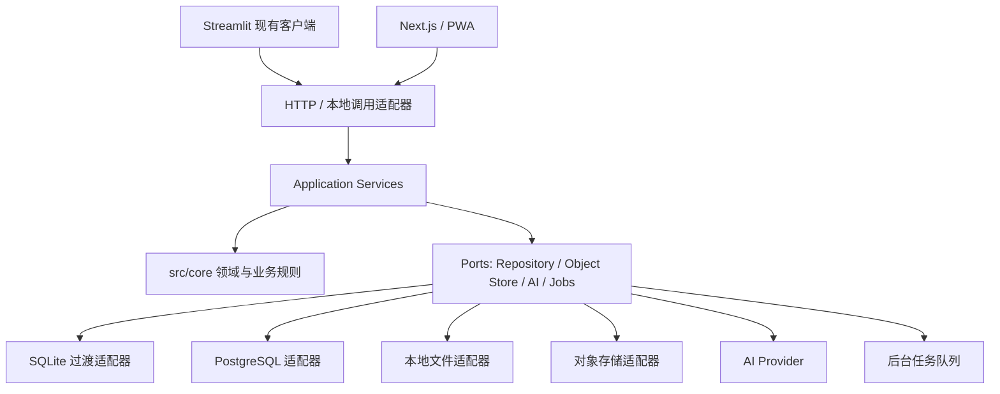

# JobFun Phase 4 服务化架构边界

状态：**架构复核完成（2026-11-20）**

本文只确定服务化边界、迁移顺序和验收规则，不在本轮引入 FastAPI、PostgreSQL、对象存储或 Next.js。

## 1. 目标与非目标

### 目标

- 让 Streamlit 和未来的 Next.js/PWA 复用同一套业务能力；
- 在任何用户数据进入 HTTP 接口前建立身份与资源所有权边界；
- 保留当前已经通过验收的匹配、证据、申请和面试业务规则；
- 允许 SQLite、本地文件和同步 AI 调用逐步替换，而不是一次性重写；
- 为后台任务、限流、成本记录和可观测性预留稳定接入点。

### 本阶段暂不处理

- 不在第一轮服务化时重写匹配或面试评分算法；
- 不让 FastAPI 路由直接读写 SQLite；
- 不让客户端提交或选择可信的 `user_id`；
- 不同时迁移数据库、文件存储、前端和 AI 任务系统；
- 不把 Streamlit `session_state` 当作跨端业务状态。

## 2. 当前结构复核

### 可以直接保留

- `src/core` 没有导入 Streamlit，核心匹配、证据和面试规则可继续复用；
- `src/db/models.py` 使用普通 dataclass，适合作为过渡期内部模型；
- 多个核心入口已经支持注入 `Database`，测试能够使用临时 SQLite；
- AI 提示词、输出校验、证据定位和固定 Rubric 已与页面渲染分离；
- 当前完整业务闭环已有自动化测试，可作为服务迁移的回归基线。

### 必须先加边界

| 当前情况 | 服务化风险 | 处理决定 |
|---|---|---|
| `get_db()` 返回进程级全局 SQLite 连接 | 并发请求共享连接和事务边界 | 由请求级 Unit of Work/Repository 管理连接 |
| 多处默认 `user_id=1` | 资源可能跨用户读取 | 身份只能来自认证上下文，查询必须附带所有权条件 |
| `Database.get/list/find_by` 是通用 CRUD | 路由容易绕过业务与授权 | 路由只调用 Application Service，不直接调用通用 CRUD |
| 匹配、证据、题目等表没有统一 `user_id` | 无法仅按当前表判断所有权 | 过渡期通过 resume/JD/application 关联校验，迁移时补齐租户键和索引 |
| 文件记录保存本地绝对路径 | 容器和多实例无法共享 | 业务层保存对象键，适配器负责本地路径或对象存储映射 |
| AI 调用同步执行 | HTTP 超时、重试和重复计费 | 短任务保留同步；长任务改为带幂等键的后台 Job |
| 页面状态保存在 `st.session_state` | 其他客户端无法恢复流程 | 可恢复状态进入数据库；纯展示状态留在客户端 |
| 内部异常直接向 UI 展示 | API 可能泄露实现和路径 | 在 HTTP 边界映射为稳定错误码与安全消息 |

## 3. 目标分层



依赖只能向内：

1. `ui`、未来 `src/api` 和客户端适配器可以依赖 Application Service；
2. Application Service 可以依赖 `src/core`、领域模型和抽象 Port；
3. `src/core` 不得依赖 Streamlit、FastAPI、Starlette、HTTP Schema 或具体前端；
4. Repository、对象存储和任务队列适配器实现 Port，但业务层不得反向导入具体适配器；
5. API Schema 与数据库模型分离，禁止直接把数据库行作为响应返回。

## 4. 请求与用户隔离

每个受保护请求必须先构造服务端认证上下文：

```text
RequestContext
├── user_id       由认证凭据解析，客户端不可覆盖
├── username      认证后的安全显示名称
├── request_id    用于日志与错误追踪
├── roles         用于未来管理权限
└── idempotency_key（仅写操作需要）
```

所有权规则：

- Resume 和 JobDescription：直接按 `user_id` 校验；
- MatchResult：同时验证其 Resume 与 JobDescription 均属于当前用户；
- Application：按 `application.user_id` 校验，并再次验证绑定的 Resume、JD 和 Match 关联一致；
- Evidence：经 MatchResult 反查所有权；
- InterviewQuestion：经 MatchResult 反查所有权；
- InterviewAttempt 和 FollowUp：经 Application、Question、Match 三方关联校验；
- 音频、PDF 和源文件：对象键必须归属当前用户，下载使用短时授权，不返回服务器路径。

任何资源不存在或不属于当前用户，对外统一返回 `404 resource_not_found`，避免通过 `403` 暴露其他用户资源是否存在。

## 5. Application Service 边界

建议按用例拆分，而不是按数据库表拆分：

| Service | 职责 | 首批方法 |
|---|---|---|
| `WorkbenchService` | 聚合当前用户工作台 | `get_summary(context)` |
| `ResumeService` | 上传、解析、版本与文件引用 | `list_resumes`、`get_resume`、`create_resume` |
| `JobService` | JD 解析与岗位资料 | `list_jobs`、`get_job`、`create_job` |
| `MatchService` | 匹配、证据矩阵和复核 | `create_match`、`get_match`、`review_evidence` |
| `ApplicationService` | 申请、时间线与下一步 | `list_applications`、`get_application`、`update_status` |
| `InterviewService` | 题目、回答、追问与洞察 | `list_questions`、`submit_answer`、`get_insights` |
| `ExportService` | 用户数据导出和删除编排 | `request_export`、`request_deletion` |

Service 负责授权、事务、幂等性和多个核心函数的编排；`src/core` 继续负责评分、校验和领域计算。

## 6. HTTP 契约草案

### 基础与身份

- `GET /health/live`：进程存活，不访问外部依赖；
- `GET /health/ready`：检查数据库和必要配置；
- `GET /api/v1/me`：返回当前认证用户的安全概要。

### 第一批只读主流程

- `GET /api/v1/workbench`；
- `GET /api/v1/resumes`、`GET /api/v1/resumes/{resume_id}`；
- `GET /api/v1/jobs`、`GET /api/v1/jobs/{job_id}`；
- `GET /api/v1/applications`、`GET /api/v1/applications/{application_id}`；
- `GET /api/v1/applications/{application_id}/interview-insights`。

### 后续写入和 AI 任务

- `POST /api/v1/resumes`、`POST /api/v1/jobs`；
- `POST /api/v1/matches`；
- `POST /api/v1/applications`、`PATCH /api/v1/applications/{application_id}`；
- `POST /api/v1/interview-attempts`；
- `POST /api/v1/exports`、`DELETE /api/v1/account-data`；
- `GET /api/v1/jobs/{job_id}/operations/{operation_id}` 查询长任务状态。

统一错误结构：

```json
{
  "error": {
    "code": "resource_not_found",
    "message": "请求的资源不存在",
    "request_id": "req_...",
    "details": {}
  }
}
```

`details` 不得包含密钥、提示词全文、简历原文、服务器路径、SQL 或异常堆栈。

## 7. 数据与文件迁移原则

- SQLite 继续作为本地开发适配器，不在创建 FastAPI 的同时删除；
- PostgreSQL Schema 使用显式外键、事务、UTC 时间和 `user_id`/租户索引；
- 先写 Repository 契约测试，再让 SQLite 与 PostgreSQL 运行同一组行为测试；
- 音频、PDF、LaTeX 源文件改存逻辑对象键，例如 `users/{user_id}/resumes/{resume_id}/...`；
- 数据库只保存对象键、内容类型、大小、校验和与保留策略；
- 删除账户数据时先冻结写入，再删除数据库记录与对象，最后写不含用户内容的审计结果。

## 8. 后台任务与成本控制

下列操作进入后台任务候选：简历解析、JD 图片/PDF 识别、匹配与证据分析、面试题生成、语音转写、PDF 编译和批量导出。

每个 Job 至少记录：

- `user_id`、操作类型、输入资源 ID；
- 状态、进度、重试次数、创建/开始/完成时间；
- 模型、输入/输出 token 或音频时长、估算成本；
- 幂等键和安全错误码；
- 不包含完整简历、JD、回答或提示词的结构化日志。

限流同时考虑用户、IP、操作类型和成本预算。服务端必须在调用供应商前完成配额检查。

## 9. 迁移顺序

### Iteration 0.20：服务骨架（已完成，2026-11-20）

- 新增独立 `src/api` 入口、配置和版本化路由；
- 实现 live/ready health、统一错误响应和请求 ID；
- 建立 `RequestContext`、Application Service 接口和依赖注入；
- 不开放任何用户数据端点。

### Iteration 0.21：认证与所有权（已完成，2026-11-20）

- 接入最小认证流程；
- 实现 Repository 所有权查询与跨用户拒绝测试；
- 禁止 API 接收可信 `user_id`。

### Iteration 0.22：只读主流程（已完成，2026-11-20）

- 迁移工作台、简历、岗位、申请和面试洞察只读接口；
- 让 Streamlit 可选地通过 Service 调用，验证双入口行为一致。

### Iteration 0.23：写入与 AI Job（已完成，2026-11-20）

- 迁移上传、匹配、申请状态和面试回答；
- 增加幂等、后台任务、限流与成本记录。

### Iteration 0.24：PostgreSQL 与对象存储（本地验收完成，2026-11-20）

- 新增 PostgreSQL 数据库适配器与可选真实 DSN 契约测试；
- 新增本地/S3 对象存储适配器；
- 新增所有权隔离、幂等的 multipart 二进制上传与对象元数据接口；
- 当前环境没有 PostgreSQL 服务，真实 PostgreSQL 联调仍需在隔离测试库执行。

### Iteration 0.25：导出与受控删除（已完成，2026-11-20）

- 新增当前用户 ZIP 数据导出与对象完整性校验；
- 新增一次性删除 Challenge、用户名与固定短语二次确认；
- 新增匿名删除审计、完整数据关系链级联和对象清理补偿队列；
- 旧本地文件路径存在时拒绝删除，必须先迁移至托管对象存储。

### Iteration 0.26：Next.js/PWA 客户端基础（已完成，2026-11-21）

- 新增独立 Next.js App Router 客户端，不改动现有 Streamlit 入口；
- 使用 HttpOnly Cookie BFF 复用现有 Bearer Token 认证；
- 新增登录、错误边界、离线壳、PWA Manifest 和响应式桌面/手机布局；
- 只搭建主流程承载框架，不在本轮迁移业务页面。

### Iteration 0.27：只读工作台与列表页（已完成，2026-11-21）

- 接入 `/workbench`、`/resumes`、`/jobs` 和 `/applications` 现有契约；
- 新增真实工作台、简历版本、岗位概况和申请跟踪四个响应式页面；
- 新增服务端分页、统一加载、空状态和 API 错误边界；
- 保持全轮只读，不迁移写入、上传、匹配执行或面试回答。

### Iteration 0.28：只读详情与证据闭环（已完成，2026-11-21）

- 新增简历、岗位和申请详情动态路由；
- 展示简历结构化经历、岗位要求与原文、申请历史快照和备注；
- 新增五维匹配分数、已有证据、能力差距和风险提示；
- 新增资源级 404、列表/工作台详情入口和响应式详情布局；
- 修复本地 Service Worker 缓存旧开发样式的问题。

### Iteration 0.29：导入与异步解析状态（已完成，2026-11-21）

- 新增简历与岗位导入页，将现有 `POST /resumes`、`POST /jobs` 接入同源 BFF；
- 每次提交使用独立幂等键，并轮询用户隔离的 `/operations/{id}`；
- 展示排队、执行、完成、失败、进度和自动重试次数，完成后进入新资源详情；
- 新增简历源和岗位源 multipart 文件暂存，客户端校验类型、空文件和大小；
- 明确保留现有后端能力边界：上传对象尚未连接解析队列，页面不伪造解析结果；
- 保持匹配执行、申请写入和面试回答不变。

### Iteration 0.30：受控匹配执行（已完成，2026-11-21）

- 新增匹配工作区，一次读取当前账户的简历与岗位候选项；
- 用户必须显式选择一个简历版本和一个目标岗位，客户端再提交现有 `POST /matches`；
- 每次请求使用独立幂等键，轮询用户隔离的 `/operations/{id}` 并展示自动重试；
- 成功后使用 `result_refs.match_id` 确认报告已生成，进入岗位详情的最新匹配证据报告；
- 没有伪造独立匹配详情接口，继续复用现有岗位读模型；
- 不创建或更新申请，也不迁移面试回答。

### Iteration 0.31：申请记录受控写入（已完成，2026-11-21）

- 匹配成功后携带岗位、简历和报告引用进入申请确认页；
- 创建页重新执行用户隔离的岗位/简历读取，并要求报告仍为岗位最新结果；
- 使用现有 `POST /applications` 创建 `saved` 状态记录，不把匹配等同于实际投递；
- 申请详情使用 `PATCH /applications/{id}` 更新状态、下一步、日期和追加备注；
- 前端状态选项与后端 `STATUS_FLOW` 一致，只允许单步合法迁移；
- 创建和更新都使用独立幂等键，只发送最小必要字段；
- 不迁移面试回答或语音能力。

### Iteration 0.32：文字面试练习与复盘（已完成，2026-11-21）

- 新增用户隔离的申请面试题列表与单次作答详情读模型；
- 只读契约沿申请、匹配、简历和岗位关系校验所有权，并隐藏参考答案、音频路径与转写内部字段；
- Next.js 新增文字练习工作区，提交现有 `POST /interview-attempts` 并轮询异步 operation；
- 评估完成后以 `result_refs.attempt_id` 读取四维分数和结构化复盘；
- 桌面与手机布局均完成真实浏览器验收，本轮不录音、不上传音频、不转写语音；
- 因新增 HTTP 读契约，FastAPI 版本升级至 `0.26.0`，Web 包升级至 `0.32.0`。

### Iteration 0.33：受控语音练习（已完成，2026-11-21）

- 新增私有音频上传、异步转写任务和用户隔离的 24 小时草稿读取契约；
- 浏览器只有在用户明确同意后开放录音/文件选择，麦克风仅在主动点击录音时请求；
- 原音频默认在转写完成后删除，主动保留时提供用户范围内的删除接口；
- 用户必须检查并确认可编辑转写，确认文本才进入既有面试评价 Worker；
- 评价记录公开回答来源和音频保留状态，但隐藏对象键、音频路径和内部转写字段；
- FastAPI 版本升级至 `0.27.0`，Web 包升级至 `0.33.0`。

### Iteration 0.34：生产运行准备（已完成，2026-11-21）

- 新增 Worker 持续轮询模式、数据库心跳和聚合运行状态；
- 新增 `/health/worker`，用 HTTP 503 表示心跳过期、队列积压、任务停滞或 Worker 错误；
- JSON 日志采用安全字段白名单，不记录用户数据或任务 payload；
- 最终失败可发送可选 Webhook，告警发送失败不覆盖原任务状态；
- 新增生产运行手册，覆盖启动、监控、告警、事件处理、恢复与发布门禁；
- FastAPI 版本升级至 `0.28.0`，Web 包升级至 `0.34.0`，本轮未公开部署。

### Iteration 0.35：私有预发布验收包（已完成，2026-11-21）

- 新增不输出配置值的预发布门禁，检查 PostgreSQL、私有 S3、Secure Cookie、JSON 日志、Worker 身份、AI 凭据和运行阈值；
- 新增显式目标的只读健康验收，只访问 live、ready 和 worker 三个公共健康契约；
- 新增仅绑定本机端口的 PostgreSQL/MinIO 隔离模板，Bucket 默认保持私有，模板不会自动启动；
- 新增合成数据冒烟、Worker 崩溃、队列积压以及数据库/对象存储恢复演练方案；
- 本轮未改变 HTTP 契约，FastAPI 保持 `0.28.0`；Web 迭代标记升级为 `0.35.0`；
- 未创建云资源、未连接真实预发布或生产数据、未发送测试告警，也未公开部署。

### Iteration 0.36：保留音频自动到期与用户批量删除（已完成，2026-11-21）

- 主动保留的面试原音频新增 1–365 天可配置策略，默认 30 天；
- 新增有界、幂等、可重试的到期清理命令，不在应用启动时自动执行；
- 新增当前用户保留音频列表与批量删除契约，响应隐藏对象键和校验和；
- 删除对象后同步清空面试尝试中的音频引用，历史文字与评价不受影响；
- Next.js 新增音频管理页和桌面/移动导航，语音同意文案明确自动到期策略；
- FastAPI 升级至 `0.29.0`，Web 升级至 `0.36.0`；本轮未执行真实 S3 清理或公开部署。

### Iteration 0.37：清理任务运行状态、指标与告警（已完成，2026-11-21）

- 新增独立 `maintenance_runs` 表，只存任务级聚合状态，不存用户或对象明细；
- 音频到期清理记录开始、完成、最近与累计扫描/删除/失败计数，以及连续失败；
- 新增 `/health/maintenance`，用 missing/stale/warning/alerting 表达调度、卡住和连续失败状态；
- 连续失败达到配置阈值时发送一次字段白名单 Webhook，避免每轮重复告警；
- 音频管理页增加安全运行概览，保留列表和批量删除契约保持不变；
- FastAPI 升级至 `0.30.0`，Web 升级至 `0.37.0`；本轮未连接真实调度器、S3 或告警通道。

### Iteration 0.38：清理历史趋势与保留策略审计（已完成，2026-11-22）

- 新增有界 `maintenance_run_events`，按任务保留最近 90 次完成记录；
- 健康快照公开最近 12 次安全趋势与运行记录，不公开用户或对象内容；
- 新增保留策略当前状态与变更审计，首次观察只建立基线；
- 相同保留天数重复运行不产生审计噪音，真实变化只记录旧值、新值、时间和配置来源；
- 音频管理页新增运行趋势和策略变更视图，批量删除与到期规则不变；
- FastAPI 升级至 `0.31.0`，Web 升级至 `0.38.0`；本轮未连接真实基础设施或公开部署。

### Iteration 0.39：维护数据导出与可配置历史边界（已完成，2026-11-22）

- 新增 12–1000 条可配置维护历史上限，默认保持 90；
- 清理任务完成时按当前上限裁剪旧运行记录，累计状态和策略审计保持独立；
- 新增只读运维 JSON 导出，支持标准输出或创建新文件，拒绝覆盖已有文件；
- 导出只包含安全聚合状态、运行历史和策略变化，不包含用户或对象内容；
- 发布门禁新增历史边界检查；FastAPI HTTP 契约保持 `0.31.0`，Web 升级至 `0.39.0`。

### Iteration 0.40：维护导出完整性与离线验证（已完成，2026-11-22）

- 维护导出升级至 schema v2，使用确定性 JSON 和 SHA-256 校验和；
- 新增完全离线的验证命令，不连接数据库也不修改导出文件；
- 验证覆盖文件大小、UTF-8 JSON、严格字段结构、数值与时间边界、禁用敏感字段和校验和；
- 重新计算校验和不能绕过敏感字段禁用清单，未知版本或算法被拒绝；
- FastAPI HTTP 契约保持 `0.31.0`，Web 升级至 `0.40.0`。

### Iteration 0.41：可选导出认证与密钥轮换（已完成，2026-11-22）

- 维护导出升级至 schema v3，保留普通 SHA-256 校验并增加可选 HMAC-SHA256 认证；
- 密钥只从 Base64 环境 keyring 读取，导出只保存非敏感 key ID；
- active key 用于新导出，验证按 key ID 选择密钥，从而支持新旧密钥重叠轮换；
- 离线验证可要求认证，错误密钥、缺失密钥、短密钥和不完整配置均失败；
- 发布门禁验证认证配置但不回显 key ID 对应的密钥材料；
- FastAPI HTTP 契约保持 `0.31.0`，Web 升级至 `0.41.0`。

### Iteration 0.42 以后

- 本地无基础设施路线到此完成；
- 下一阶段需要用户提供隔离 PostgreSQL、S3 兼容存储和测试告警通道，执行真实预发布与恢复演练；
- 演练通过后再决定是否进入正式部署，不继续堆叠脱离真实环境的运维功能。

## 10. 每轮验收门槛

- 当前 Streamlit 流程和全部既有测试继续通过；
- 核心层不导入 Streamlit、FastAPI、Starlette 或 API Schema；
- API 路由不直接调用 `get_db()` 或通用 CRUD；
- 每个用户数据接口都有同用户成功和跨用户不可见测试；
- 写操作有重复请求测试；
- 响应和日志不包含服务器路径、凭据或其他用户数据；
- OpenAPI 契约、错误结构和实际返回一致；
- 数据库与对象存储失败能够返回安全错误并留下可追踪的 `request_id`。
